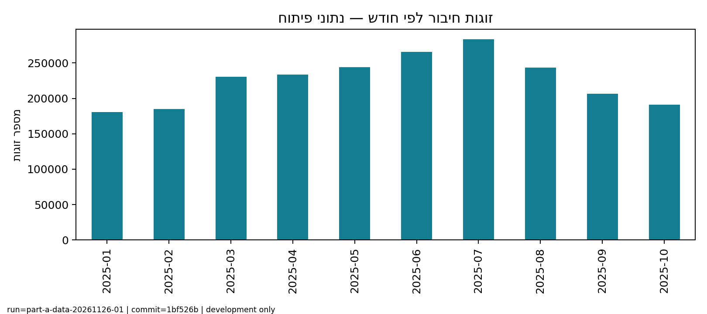
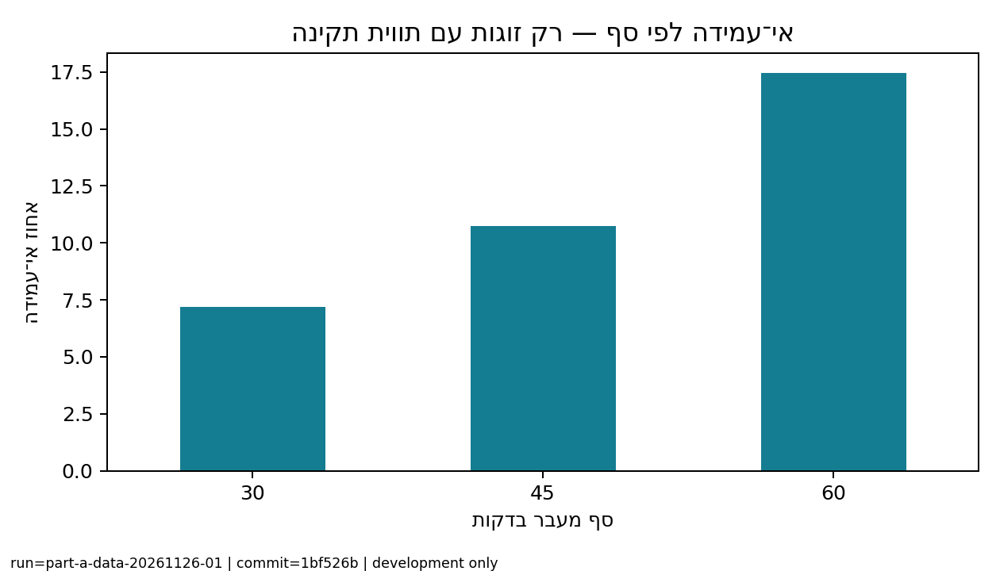
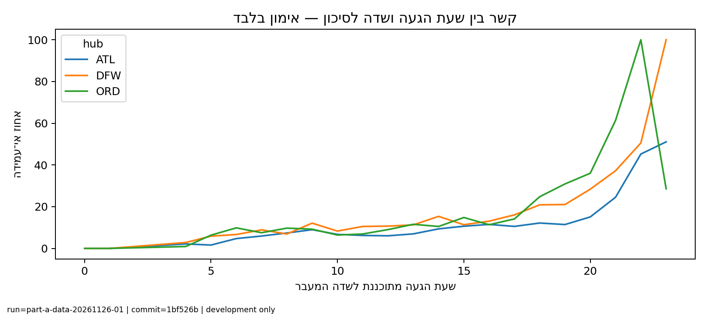

# הוכחת היתכנות — כרטיס מספרים למצגת

מקור כל התוצאות המספריות להלן: ריצה `part-a-data-20261126-01`, commit `1bf526baeeb88632e3da28f5d64a78409dd26ac2`, פלט `reports/runs/part-a-data-20261126-01/feasibility.json`. עיגול לצורכי הצגה בלבד; הערכים המלאים בפלט. ספים, שעות וחלונות הם הגדרות מהתצורה.

**המחקר רטרוספקטיבי על פיתוח בלבד. מספר זוגות אינו מספר נוסעים או תצפיות עצמאיות.**

| מדד | תוצאה | מכנה/משמעות |
|---|---|---|
| רשומות טיסה גולמיות | 5,848,765 | כל קובצי ינואר–אוקטובר, כל השדות; לפני סינון וכפילויות |
| עמודות בגולמי | 109 | ללא עמודת CSV ריקה בסוף השורה |
| זוגות מועמדים | 2,263,127 | לאחר כללי זיווג ודגימת טיסות נכנסות |
| טיסות ייחודיות בזוגות | 595,492 | לפי מזהה טיסה, לא סכום רגליים |
| תכונות בסיס | 12 | לפני הרחבת one-hot; לא כולל תוויות ומזהים |
| עמודות בקובץ הזוגות | 16 | כולל תוויות וסטטוס |
| כיסוי מקור | 2025-01-01 עד 2025-10-31 | מוגדר לפי FlightDate |
| כיסוי זוגות בפועל | 2025-01-02 עד 2025-10-29 | לא כל תאריך מקור נשמר לאחר חלונות והפרדה |
| ביטולי מקור | 1.36% | רשומות טיסה גולמיות |
| הסטות מקור | 0.29% | רשומות טיסה גולמיות |

## פיצולים

| פיצול | זוגות | טיסות ייחודיות בזוגות | ימים | תוויות תקינות | אי־עמידה בסף הראשי |
|---|---|---|---|---|---|
| train | 1,865,885 | 491,101 | 240 | 1,790,532 | 11.22% |
| validation | 206,288 | 54,468 | 27 | 203,052 | 8.45% |
| calibration | 104,145 | 26,500 | 13 | 103,412 | 6.89% |
| demo | 86,809 | 23,423 | 12 | 85,244 | 11.22% |

הימים נספרים לפי יום יציאה מקומי של הרגל הראשונה; גבולות הפיצול נבדקים ב־UTC, ולכן תאריך מקומי סמוך לגבול עשוי להיראות שונה מהתאריך בתצורה. אין חפיפת מזהי טיסה בין הפיצולים לפי בדיקת הריצה.

## עומק ורוחב הזוגות

| שדה מעבר | זוגות |
|---|---|
| ATL | 1167247 |
| DFW | 679877 |
| ORD | 416003 |

| חברה מדווחת | זוגות |
|---|---|
| AA | 603779 |
| AS | 189 |
| B6 | 27 |
| DL | 1152045 |
| F9 | 5651 |
| MQ | 153891 |
| NK | 2447 |
| OH | 6908 |
| OO | 122984 |
| UA | 186926 |
| WN | 10528 |
| YX | 17752 |

| חודש FlightDate | זוגות |
|---|---|
| 2025-01 | 180509 |
| 2025-02 | 185013 |
| 2025-03 | 230774 |
| 2025-04 | 233527 |
| 2025-05 | 243763 |
| 2025-06 | 265343 |
| 2025-07 | 283334 |
| 2025-08 | 243622 |
| 2025-09 | 206288 |
| 2025-10 | 190954 |

## רגישות לזמן מעבר

| תרחיש דקות | שיעור אי־עמידה בכל פיצולי הפיתוח |
|---|---|
| 30 | 7.18% |
| 45 | 10.76% |
| 60 | 17.45% |

המכנה כאן כולל רק זוגות בסטטוס operated. זהו תיאור פיתוח משוקלל לפי מספר זוגות, לא אומדן לאוכלוסיית נוסעים ולא מדד ביצועי מודל.

## נגישות ויכולת טכנולוגית

קובצי BTS ציבוריים וקיימים מקומית עם כתובות וטביעות ב־data/manifest.json. התהליך משתמש ב־Python, pandas, SciPy, scikit-learn ו־XGBoost. ריצת הנתונים בפועל ארכה 263.8 שניות בסביבה המתועדת ב־run.json; הזמן כולל בנייה מחדש, ביקורת ותרשימים, ואינו התחייבות למחשב אחר. האתר לא השתנה.

## חסרים

| עמודת זוגות | חסרים | אחוז |
|---|---|---|
| first_id | 0 | 0.00% |
| second_id | 0 | 0.00% |
| departure_date | 0 | 0.00% |
| origin | 0 | 0.00% |
| hub | 0 | 0.00% |
| destination | 0 | 0.00% |
| carrier | 0 | 0.00% |
| gap_minutes | 0 | 0.00% |
| duration_minutes | 0 | 0.00% |
| departure_hour | 0 | 0.00% |
| weekday | 0 | 0.00% |
| month | 0 | 0.00% |
| status | 0 | 0.00% |
| label_30 | 80887 | 3.57% |
| label_45 | 80887 | 3.57% |
| label_60 | 80887 | 3.57% |
| split | 0 | 0.00% |
| flight_month | 0 | 0.00% |

חסרים בתוויות צפויים כאשר סטטוס אינו תקין; אין למלא אותם באפס. ספירת חסרי מקור נעשתה בשדות הביקורת המפורטים ב־feasibility.json בלבד, ולא נטען שכל עמודות BTS נבדקו לחסרים.

## גרפים לשקופית

## מאגרים משלימים — הצעות בלבד

[TAF / Iowa Mesonet](https://mesonet.agron.iastate.edu/request/taf.php) מספק ארכיון תחזיות עם זמן הנפקה וזמן תוקף. מתאים אולי להחלטות בטווח קצר, ולא כמזג אוויר ידוע חודש מראש. [DB1B](https://www.transtats.bts.gov/DatabaseInfo.asp?DB_ID=125) ו־[OD40](https://www.bts.gov/OD-40) עשויים לתרום מסלולי כרטיסים ומשקלי ביקוש; אינם תוויות פספוס נוסע. קישור DB1B שנבדק החזיר שגיאה ולכן זמינותו לא אומתה בבדיקה זו. OD40 משנה משטר דיווח בתוך שנת הנתונים, ולכן אין לצרף תקופות בלי בדיקת סכמה וכיסוי. לא הורדו נתונים משלימים ולא התחייבנו לשילובם.

## איך מסבירים בהצגה

״יש לנו מקור ציבורי שניתן לשחזר, ואנחנו יודעים להבחין בין טיסה, זוג מועמד ונוסע. התוצאה שאנחנו בודקים היא זמן מעבר קצר מסף; ביטולים והסטות נשמרים בנפרד.״
