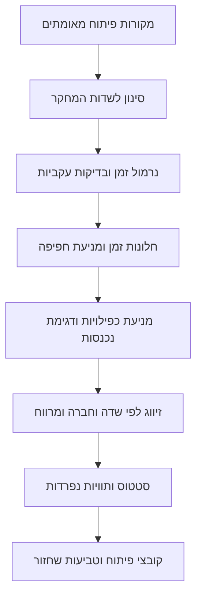

# איכות נתונים, ניקוי ושחזור

מקור כל התוצאות המספריות להלן: ריצה `part-a-data-20261126-01`, commit `1bf526baeeb88632e3da28f5d64a78409dd26ac2`, פלט `reports/runs/part-a-data-20261126-01/rebuild.json`. עיגול לצורכי הצגה בלבד; הערכים המלאים בפלט. ספים, שעות וחלונות הם הגדרות מהתצורה.

## מה נבדק בפועל

הצינור נבנה מחדש לתיקיית artifacts של הריצה. טביעות קובצי train/validation/calibration/demo זהות למקור המתועד; הקבצים הקיימים לא נדרסו. בדיקת טיסות משותפות בין הפיצולים עברה, ושחזור התווית הראשית מן הגולמי תאם לכל זוג תקין באימון.

## משפך סינון

| פיצול | רשומות מקור | קשורות לשדות המחקר | דחיות נרמול | מחוץ לגבול | כפילות מזהה | טיסות שנשמרו | נכנסות שנדגמו | זוגות |
|---|---|---|---|---|---|---|---|---|
| train | 4680482 | 1238570 | 8449 | 19254 | 0 | 1210867 | 30944 | 1865885 |
| validation | 562439 | 157451 | 798 | 22051 | 0 | 134602 | 3405 | 206288 |
| calibration | 605844 | 168150 | 930 | 102514 | 0 | 64706 | 1673 | 104145 |
| demo | 605844 | 168150 | 930 | 108575 | 0 | 58645 | 1451 | 86809 |

אוקטובר נסרק בנפרד לכיול ולהדגמה: אסור לסכום את רשומות המקור בשתי השורות כדי לתאר גודל מאגר. בשלב הזיווג יחידת הספירה משתנה מטיסה לזוג; מספר זוגות אינו יתרת שורות מהשלב הקודם.

## סיבות דחייה

| פיצול | סיבה | רשומות |
|---|---|---|
| train | 'PBI' | 8413 |
| train | scheduled_arrival_clock_mismatch | 36 |
| validation | 'PBI' | 795 |
| validation | scheduled_arrival_clock_mismatch | 3 |
| calibration | 'PBI' | 930 |
| demo | 'PBI' | 930 |

## כללי טיפול והנמקה

| בעיה | טיפול | מה לא עושים |
|---|---|---|
| hhmm וחצות | 2400 מועבר ליום הבא; משך מתוכנן בונה הגעה ב־UTC | לא מחסרים מספרי hhmm |
| אזורי זמן | מיפוי IANA ייחודי ובדיקת התאמה לשעון BTS | לא מניחים שכל שדות התעופה באותו אזור |
| מעבר שעון קיץ | דחיית שעה מקומית עמומה או לא קיימת | לא בוחרים offset בשקט |
| רשומה כפולה | מזהה לוח זמנים יציב; כפילות בתוך פיצול מוחרגת | לא סופרים אותה פעמיים |
| ביטול/הסטה | סטטוס נפרד ותווית חסרה | לא הופכים לתווית הצלחה או כשל של מרווח |
| זמן בפועל לא עקבי | סטטוס invalid_actual_time או דחייה לפי שלב | לא מתקנים בעזרת ניחוש |
| איחור חריג אמיתי | נשמר אם הוא בתוך גבולות החלוקה | לא מוחקים קיצון רק בגלל IQR |
| גבולות פיצול | מרווח יומיים ובדיקת כל זמני הטיסה | לא משתפים מזהי טיסה בין קבוצות |

בחיבור בתוך אותו שדה אפשר להשוות זמנים מקומיים כשיום הוגדר נכון; ייצוג UTC נבחר לאחידות בין רגליים, חצות וגבולות מחקר. זמן הגעה בפועל משפיע על סינון גבולות הפיצול; זו מגבלת בחירת אוכלוסייה שיש לדווח, ואינה תכונת מודל.

## זרימת הצינור

## תוצאה לצוות

״הניקוי הוא מערכת כללים מנומקת, לא מחיקה של כל שורה בעייתית. אנחנו שומרים סטטוסים ומכנים ומראים כמה רשומות עברו כל שלב.״
