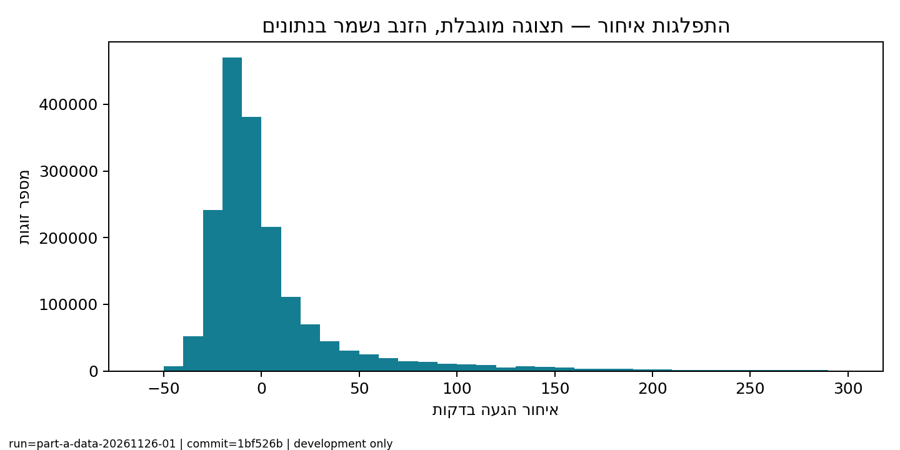
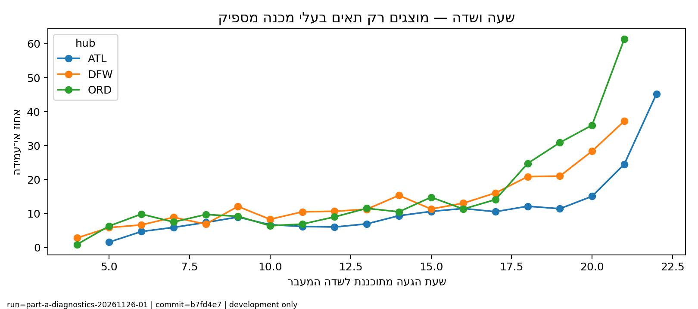
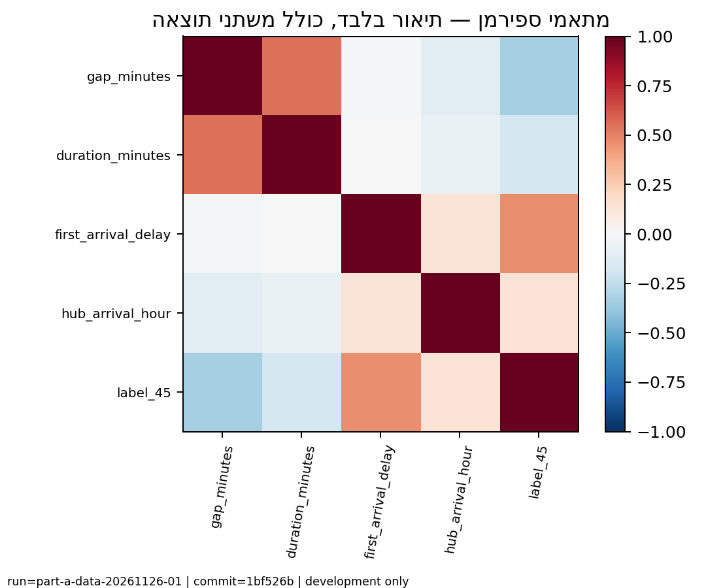
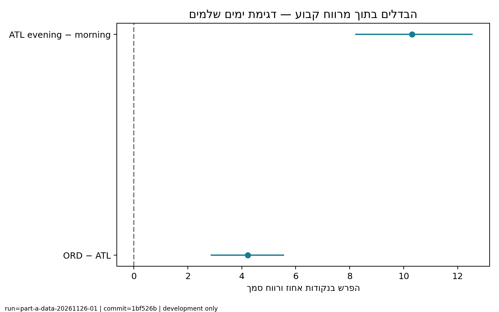

# ניתוח תיאורי והיסקי — אימון בלבד

מקור כל התוצאות המספריות להלן: ריצה `part-a-data-20261126-01`, commit `1bf526baeeb88632e3da28f5d64a78409dd26ac2`, פלט `reports/runs/part-a-data-20261126-01/analysis.json`. עיגול לצורכי הצגה בלבד; הערכים המלאים בפלט. ספים, שעות וחלונות הם הגדרות מהתצורה.

## אוכלוסייה וכללי הסקה

נותחו 1,790,532 זוגות אימון עם תווית תקינה. ההשוואות העיקריות מוגבלות למרווח מתוכנן של 60–120 דקות. הדגימה לרווחי הסמך בוחרת ימים שלמים עם החזרה ושומרת את כל הזוגות ביום. זוגות משותפים אינם תצפיות עצמאיות. הימים לפי FlightDate הראשונה, ולכן חיבור לילה עלול לחצות יום; תלות בין ימים אינה נפתרת במלואה.

## מה רואים בנתונים

| השוואה B מול A | שיעור A | שיעור B | הפרש בנקודות אחוז | רווח סמך bootstrap |
|---|---|---|---|---|
| ORD minus ATL, gap 60–120 | 9.63% | 13.85% | 4.23 | 2.85 עד 5.57 |
| ATL evening minus morning by hub scheduled arrival hour, gap 60–120 | 5.57% | 15.89% | 10.32 | 8.21 עד 12.56 |

נמצא קשר בין שדה/שעה ובין הסיכון גם בתוך טווח מרווח מוגבל. אין להסיק ששדה או שעה גורמים להבדל: הרכב מסלולים, חברות ומרווח מדויק עדיין משתנה. שעת הניתוח היא הגעה מתוכננת לשדה המעבר, ולא שעת היציאה של הרגל הראשונה.

### בדיקת טווחים צרים

| מרווח דקות | הפרש ORD−ATL בנקודות אחוז | רווח סמך |
|---|---|---|
| [60, 74] | 4.39 | 2.44 עד 6.34 |
| [75, 89] | 3.47 | 1.91 עד 5.09 |
| [90, 104] | 3.61 | 2.27 עד 5.03 |
| [105, 120] | 2.55 | 1.31 עד 3.78 |

הבדיקה מצמצמת ערבוב לפי מרווח אך אינה מודל מותאם לכל מאפייני המסלול. זו בדיקת גישוש על אימון, לא השערה מאששת שנרשמה לפני חשיפה לכל נתוני הפיתוח.

## גרפים ותובנות

ההתפלגות אינה סימטרית; הקצוות אינם נמחקים. הגרף מגביל את ציר התצוגה בלבד.

הקשר בין שעה לסיכון שונה בין שדות; הגרף הזה אינו מחזיק את המרווח קבוע, ולכן ההשוואות בטבלה נדרשות בנפרד.

זהו תיאור של זוגות אימון. משתני תוצאה מופיעים במפת המתאם לצורך הבנה בלבד ואינם מתווספים לקלט המודל.

רווחים מתקבלים מדגימת ימים, ולא מדגימת כל זוג כאילו היה עצמאי.

## שיטות דרגות — מדוע ומה מגבלותיהן

איחורים מוטים ובעלי זנב, ולכן אין להניח נורמליות אוטומטית. מבחן דרגות גם הוא דורש הנחות: Mann–Whitney ו־Kruskal–Wallis שנשמרו בפלט הם אבחונים משלימים בלבד, משום שקבוצות השדה/השעה חולקות ימים ומערכת תעופה. **אין להשתמש בערכי ה־p שלהם כהוכחה להבדל תחת עצמאות.** Wilcoxon על ימים מזווגים מתאים יותר למבנה ההשוואה, אך גם הוא מוגבל בסימטריית הפרשים ובתלות בזמן. ההפרש ורווח הימים הם התוצאה המרכזית. בפלט נשמר תיקון Holm למשפחת מבחני הדרגות, שאינו מתקן הפרת הנחות.

Spearman על ממוצעים יומיים של טיסות נכנסות ייחודיות נתן rho=-0.055. אין לפרש אותו כמתאם בין כל זוג למאפייניו או כראיה שאין קשר בכל רמת פירוט; בחירת מועמד אחד לטיסה משנה את יחידת הניתוח. ערך p הנאיבי נשמר בפלט ואינו מסקנת ההסקה הראשית.

## רגישות להגדרת ההמראה השנייה

| סף | אי־עמידה מול יציאה מתוכננת | מול יציאה בפועל | שיעור שינוי תווית |
|---|---|---|---|
| 30 | 7.59% | 5.70% | 2.55% |
| 45 | 11.22% | 8.84% | 4.01% |
| 60 | 17.91% | 14.54% | 5.93% |

בנתונים אלה שימוש בהמראה בפועל מפחית את שיעור אי־העמידה הכולל, אך גם יציאה בפועל אינה מועד סגירת השער. אין להסיק שהמדד הראשי הוא תמיד חסם עליון לסיכון פספוס של נוסע.

## מספר זנב

| אותו זנב נצפה | זוגות | אי־עמידה ראשית | אי־עמידה מול יציאה בפועל |
|---|---|---|---|
| False | 1770280 | 11.15% | 8.85% |
| True | 20252 | 17.47% | 7.94% |

הבדל בין שתי הגדרות הזמן בולט בזוגות אותו מטוס: איחור ברגל הראשונה עשוי להתלוות לאיחור בשנייה. זו אסוציאציה, אינה הבטחת המתנה לנוסע. הכלל הקיים מחריג אותו מספר טיסה ולכן אין כאן כיסוי מלא של סבבי מטוסים.

## כיצד מסבירים למרצה

״אנחנו בודקים אם שעה ושדה מוסיפים מידע מעבר לזמן ההמתנה. מציגים גודל הבדל ורווח סמך, שומרים תלות בתוך יום, ובודקים עד כמה שינוי הגדרת התוצאה משנה את התמונה.״

## השלמה: ימים מזווגים ומכנים בתרשים

מקור כל התוצאות המספריות להלן: ריצה `part-a-diagnostics-20261126-01`, commit `b7fd4e725af2941b9c4c968125a97021e124f1d1`, פלט `reports/runs/part-a-diagnostics-20261126-01/paired_tests.json`. עיגול לצורכי הצגה בלבד; הערכים המלאים בפלט. ספים, שעות וחלונות הם הגדרות מהתצורה.

Friedman על 240 ימים משותפים: סטטיסטי 43.022, p=4.55e-10. Wilcoxon על 238 ימים משותפים בבוקר/ערב ATL: p=6.14e-16. הבדיקות שומרות זיווג ימים אך לא מבטלות תלות בין ימים או ערבוב מסלולים; גישוש בלבד.

בתרשים השעה מוצגים תאים עם לפחות 500 זוגות; 11 תאים קטנים אינם מוצגים. המכנים נמצאים ב־reports/runs/part-a-diagnostics-20261126-01/hour_hub_denominators.csv. זהו כלל תצוגה בלבד.
