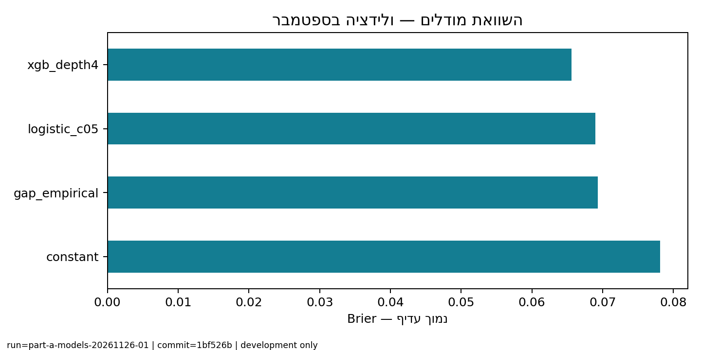
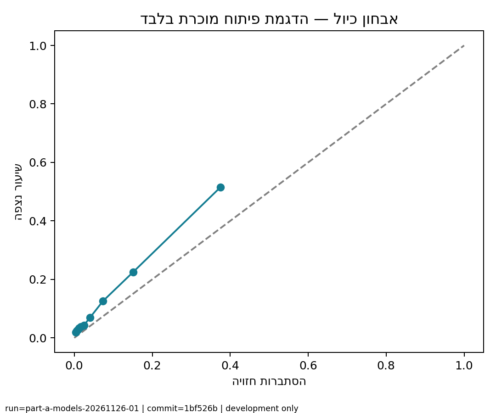

# ניסוי מודלים וכיול — פיתוח בלבד

מקור כל התוצאות המספריות להלן: ריצה `part-a-models-20261126-01`, commit `1bf526baeeb88632e3da28f5d64a78409dd26ac2`, פלט `reports/runs/part-a-models-20261126-01/models.json`. עיגול לצורכי הצגה בלבד; הערכים המלאים בפלט. ספים, שעות וחלונות הם הגדרות מהתצורה.

**המודלים הורצו מחדש לתיקיית artifacts נפרדת. האתר והמודל שבו לא הוחלפו. תוצאות demo אינן TEST.**

## סינון על חלונות זמן

| תצורה | ממוצע Brier בסינון |
|---|---|
| constant | 0.10858 |
| gap_empirical | 0.09164 |
| logistic_c05 | 0.08997 |
| tree_depth4 | 0.08927 |
| random_forest12 | 0.08598 |
| hist_boost | 0.08622 |
| xgb_depth4 | 0.08567 |

## ולידציה — תרחיש ראשי

| מודל | Brier | ROC-AUC | Average Precision |
|---|---|---|---|
| constant | 0.07812 | 0.5000 | 0.0845 |
| gap_empirical | 0.06931 | 0.7857 | 0.2620 |
| logistic_c05 | 0.06893 | 0.8044 | 0.3021 |
| xgb_depth4 | 0.06556 | 0.8169 | 0.3579 |

נבחר xgb_depth4 לפי Brier בוולידציה. זהו שיפור נקודתי בפיתוח, לא הוכחת יתרון על תקופה עצמאית או שימוש תפעולי. היקפי האימון/הוולידציה והפרמטרים המלאים בפלט.

## כיול והדגמת פיתוח

| סף | מודל | שיטת כיול | Brier בהדגמה | שיעור נצפה |
|---|---|---|---|---|
| 30 | xgb_depth4 | temperature | 0.05889 | 6.99% |
| 45 | xgb_depth4 | sigmoid | 0.07825 | 11.22% |
| 60 | xgb_depth4 | sigmoid | 0.08672 | 18.35% |

כיול נבחר בחלון נפרד באוקטובר; אחריו נבדק demo מוכר. יש לבחון את הפער בין חזוי לנצפה לאורך טווחי הסיכון, ולא להסיק כיול טוב רק מ־AUC. בחירות עבר ותצורות כבר נחשפו לפיתוח, ולכן אין לכנותו ניסוי מאשש.

## האם זה משפר בחירת מסלול?

| כלל בחירה | בחירות | תוצאות ידועות | אי־עמידה בתוצאות ידועות | משך ממוצע בדקות |
|---|---|---|---|---|
| shortest | 5843 | 5731 | 20.31% | 346.8 |
| longest_gap | 5843 | 5737 | 9.12% | 377.7 |
| lowest_risk | 5843 | 5739 | 8.57% | 375.7 |

בהשוואה מזווגת של סיכון נמוך מול מרווח ארוך, ההפרש הוא -0.54 נקודות אחוז, ורווח הסמך -1.66 עד 0.32. הרווח כולל אפס: **אין ראיה מספקת ליתרון על כלל המרווח הארוך בתקופה זו**. אסור להציג רק את שיעורי הקבוצות השונים כהוכחת תועלת.

השוואת הכללים מוגבלת לחלופות עד משך מינימלי ועוד תוספת הזמן שהוגדרה בפרוטוקול; המכנים של תוצאות ידועות שונים בין כללים. ביטולים והסטות אינם נעלמים: ספירותיהם המלאות ב־models.json. הקבוצות אינן מאגר כרטיסים מסחריים ולא נמדד מחיר.

## מסקנה ניהולית

יש הצדקה להמשך המחקר: מודל הסתברות מוסיף חיזוי בפיתוח, אך קידום מוצר דורש גם כיול יציב, יתרון מעשי מול כלל פשוט ואימות זמינות בזמן. אין בסיס להבטחת קונקשן או להכרזה שהפרויקט אומת סופית.
