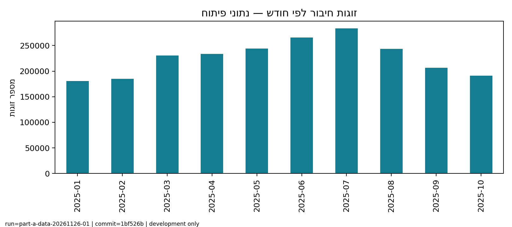
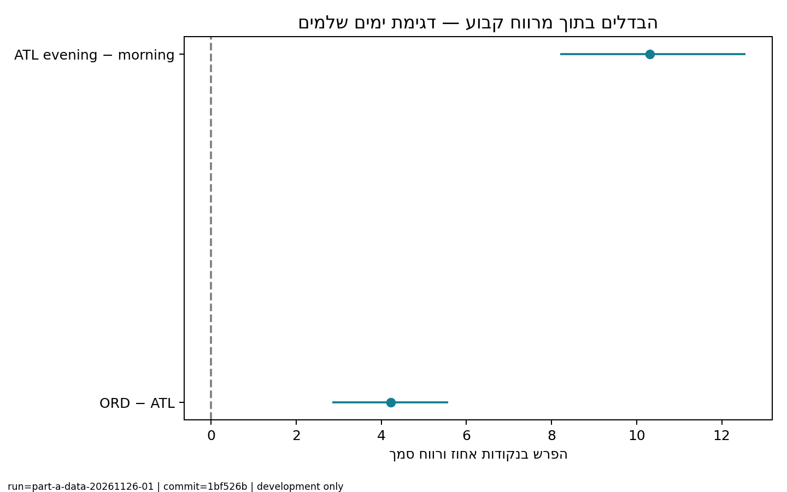
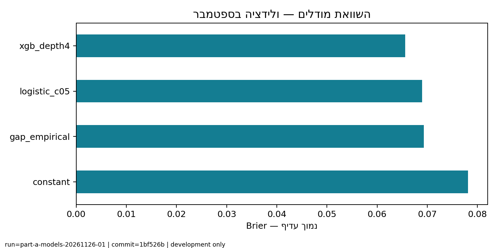

# ConnectionScore — טיוטת דוח חלק א

הנדסת תעשייה וניהול, התמחות מדעי הנתונים. גרסת עבודה לצוות, 26.11.2026.

טיוטה מבוססת הרצות פיתוח. נדרשת קריאת הצוות ואישור הגדרות מול המנחה. אין כאן תוצאות TEST, אישור תפעולי או הגשה בשם הסטודנטים.

## תקציר

הפרויקט בוחן הערכת סיכון לחיבור בין שתי טיסות פנים בארה״ב. המדד הוא אי־עמידה בזמן מעבר מוגדר, ולא פספוס נוסע בפועל. מקור הנתונים הוא BTS. בריצת השחזור נספרו 5,848,765 רשומות טיסה גולמיות מינואר עד אוקטובר 2025, ומהן נבנו 2,263,127 זוגות מועמדים לאחר סינון ודגימה. בזוגות מופיעות 595,492 טיסות ייחודיות. מספר זוגות אינו מספר תצפיות עצמאיות.

מקור: ריצה part-a-data-20261126-01; commit 1bf526baeeb88632e3da28f5d64a78409dd26ac2; פלט reports/runs/part-a-data-20261126-01/feasibility.json.

נמצאו קשרים בין שדה מעבר ושעה ובין הסיכון גם בתוך טווח מרווח מוגבל. ניסוי מודלים מצא שיפור חיזוי בפיתוח לעומת בסיסים פשוטים, אך ניסוי בחירת המסלול אינו מספק ראיה ליתרון על כלל המרווח הארוך. השימוש המוצרי לפני הזמנה דורש אימות זמינות לוחות והיסטוריה בזמן. כל ההערכה הנוכחית רטרוספקטיבית.

## הבעיה, המשתמש והתועלת ההנדסית

משתמש המתכנן נסיעה משווה מסלולים לפי משך ומרווח, אך אותו מרווח עשוי להיות קשור לרמות שונות של סיכון היסטורי. מטרת ConnectionScore היא להציג הסתברות מוסברת במסגרת תחולה ברורה ולבחון אם היא מסייעת לבחירה תחת מגבלת זמן.

הערך התעשייתי־ניהולי אינו מסתכם בבניית מסווג: נדרש להגדיר תהליך החלטה, אילוץ משך, בסיס השוואה ומדד תועלת. בשלב זה אין נתוני מחיר, עלויות טיפול בנוסע או תצפיות על פספוסים אמיתיים; לכן לא מוצג חיסכון כספי מומצא.

## שאלת המחקר והיקף

באיזו מידה מאפייני לוח זמנים של זוג טיסות מנבאים שהזמן הזמין למעבר יהיה קצר מסף מוגדר? האם דירוג לפי הסיכון משפר בחירה ביחס למסלול הקצר או למרווח הארוך באותה מגבלת משך?

האוכלוסייה הנוכחית: טיסות פנים דרך ATL, ORD או DFW, באותה חברה מדווחת, עם מרווח מתוכנן של 30–240 דקות, מספרי טיסה שונים וללא חזרה למוצא. כרטיס משותף, כבודה ליעד והישארות באזור המאובטח הם הנחות תחום, שאינן מאומתות מעצם חברותה של טיסה ב־BTS. ההגדרות הן תצורת העבודה הקיימת, ולא אישור מנחה חדש.

התווית: אי־עמידה אם יציאה מתוכננת שנייה פחות הגעה בפועל לשער ראשונה קטנה מסף התרחיש. הספים בתצורה הם 30, 45 ו־60 דקות; 45 הוא הראשי. שוויון לסף הוא עמידה. ביטול והסטה הם סטטוסים נפרדים, לא כשל או הצלחה של יעד המרווח. זהו מדד תחליפי ולא MCT רשמי או תוצאת נוסע.

## מקורות נתונים והיתכנות

מקורות הטיסות, כתובות ההורדה וטביעות הקבצים מתועדים ב־data/manifest.json וב־docs/sources.md. מיפוי אזורי הזמן הוא מקור קהילתי בגרסה נעולה. המיפוי חסר את PBI, וטיסות קשורות הוחרגו; נדרש מקור מוסמך או הגדרת כיסוי מצומצם מפורשת.

בגולמי 109 עמודות בעלות שם; במודל הבסיס 12 תכונות לפני הרחבת קידוד הקטגוריות. שיעור ביטולי המקור 1.36% וההסטות 0.29%, עם מכנה רשומות טיסה. אין לערבב מכנה זה עם מכנה זוגות תקינים.

מקור: ריצה part-a-data-20261126-01; commit 1bf526baeeb88632e3da28f5d64a78409dd26ac2; פלט reports/runs/part-a-data-20261126-01/feasibility.json.

הנתונים הציבוריים נגישים והצינור ניתן לשחזור. עומק הנתונים מאפשר לחקור הבדלים בין חודשים, חברות ושדות, אבל זוגות רבים חולקים טיסה ולכן נפח הקובץ אינו גודל מדגם עצמאי.

## טיפול בנתונים

הצינור ממיר hhmm לחותמות זמן מלאות, מטפל בחצות ובמעברי שעון, ממפה אזורים, בודק התאמה לזמני BTS, מסנן גבולות זמן, מונע כפילות מזהים ובונה זוגות לפי שדה וחברה. דגימת הטיסות הנכנסות נקבעת לפי מזהה לוח זמנים, ללא שימוש בתוצאה. פירוט כמויות בכל שלב מופיע ב־docs/02_data_quality.md.

בשחזור נבנו קובצי פיתוח חדשים לתיקייה נפרדת וטביעותיהם התאימו למקור. לא נדרסו נתונים גולמיים. נבדק שאין מזהי טיסה משותפים לפיצולים. תוויות חסרות לא מולאו באפס ואיחורים אמיתיים לא הוסרו רק מפני שהם קיצוניים.

החלוקה כרונולוגית: אימון בינואר–אוגוסט, ולידציה בספטמבר, כיול והדגמת פיתוח בחלונות נפרדים באוקטובר, עם מרווחי הפרדה. תאריכי FlightDate מקומיים עשויים להיות סמוכים לתאריך UTC אחר. זמן הגעה בפועל משמש גם לבדיקת גבול הפיצול; זו מגבלת בחירת אוכלוסייה שדורשת דיווח.

## סטטיסטיקה תיאורית והיסקית

בכל פיצולי הפיתוח, בקרב זוגות עם תווית תקינה בלבד, שיעורי אי־העמידה הם 7.18%, 10.76% ו־17.45% בהתאמה לתרחישים. אלה שיעורי תוצאה, לא ציוני המודל.

מקור: ריצה part-a-data-20261126-01; commit 1bf526baeeb88632e3da28f5d64a78409dd26ac2; פלט reports/runs/part-a-data-20261126-01/feasibility.json.

בנתוני האימון ובמרווח מתוכנן 60–120 דקות, ORD לעומת ATL הציג הפרש של 4.23 נקודות אחוז, עם רווח סמך דגימת ימים 2.85 עד 5.57. ב־ATL, ערב לעומת בוקר לפי שעת הגעה מתוכננת הציג הפרש של 10.32 נקודות אחוז, ורווח 8.21 עד 12.56.

מקור: ריצה part-a-data-20261126-01; commit 1bf526baeeb88632e3da28f5d64a78409dd26ac2; פלט reports/runs/part-a-data-20261126-01/analysis.json.

נדגמו ימים שלמים כדי לשמור תלות בין זוגות באותו יום. נוספו השוואות בטווחי מרווח צרים ומבחנים מזווגים בין ימים; יש לדווח שהם גישושיים ושתלות סדרתית וערבוב מסלולים עדיין קיימים. היעדר נורמליות אינו פוטר מבדיקת הנחות מבחן דרגות. פרטי Friedman ו־Wilcoxon ותוצאותיהם נמצאים ב־docs/03_analysis.md ובפלט הריצה הנוספת.

בניתוח הרגישות, יעד המבוסס על המראת ההמשך בפועל שינה את שיעורי אי־העמידה. נבחן גם אותו מספר זנב בשתי הרגליים. שני הנתונים הם מידע בדיעבד ומשמשים לבדיקת משמעות המדד בלבד, לא כקלט בתכנון. התוצאות אינן מוכיחות ששדה מסוים, שעה או מטוס גורמים לכשל.

## רשומת קלט וניסוי מודלים מקדים

רשומה כוללת מסלול, חברה, מרווח ומשך מתוכננים ומאפייני זמן מחזוריים. תוויות, סטטוס, איחורים, מספר זנב ומזהי טיסה נחסמים כתכונות. זמינות לוח מדויק במועד הזמנה עדיין לא הוכחה; גם השוואה כרונולוגית אינה פותרת זאת.

ניסוי ההמשך השווה מודלי בסיס, לוגיסטית, עץ, יער ו־boosting על חלונות עבר. בתרחיש הראשי, בוולידציית ספטמבר, Brier של שיעור קבוע היה 0.07812, מרווח בלבד 0.06931, לוגיסטית 0.06893 ו־XGBoost 0.06556. ערך נמוך עדיף. אין להחליף כאן חיזוי הסתברותי ב־Accuracy בלבד.

מקור: ריצה part-a-models-20261126-01; commit 1bf526baeeb88632e3da28f5d64a78409dd26ac2; פלט reports/runs/part-a-models-20261126-01/models.json.

כיול נבחר בחלון נפרד, והדגמת סוף אוקטובר משמשת אבחון פיתוח שכבר נצפה. אלה אינם ביצועי TEST. בתרחיש הראשי, ממוצע הסיכון החזוי בהדגמה הוא 7.14%, לעומת 11.22% נצפה (מקור: אותה ריצת מודלים, ממוצע משוקלל מתאי הכיול). קיימת הערכת חסר גם לאחר כיול, ולכן המודל אינו מוכן לשימוש תפעולי. האתר ממשיך להשתמש בגרסה הקיימת, ללא החלפת מודל אוטומטית.

## תועלת, סיכונים ומשמעות ניהולית

בניסוי חלופות מדגמיות תחת אותו אילוץ משך, סיכון נמוך לעומת כלל המרווח הארוך נתן הפרש מזווג של -0.54 נקודות אחוז ורווח סמך -1.66 עד 0.32. הרווח כולל אפס. לכן אין כרגע ראיה מספקת ליתרון על כלל זה, גם אם מדד החיזוי השתפר.

מקור: ריצה part-a-models-20261126-01; commit 1bf526baeeb88632e3da28f5d64a78409dd26ac2; פלט reports/runs/part-a-models-20261126-01/models.json.

סיכונים שלא נמדדו ישירות כוללים זמני הליכה, סגירת שער, תנועת כבודה, ניידות אישית ותהליכי מכס/בידוק. כבודה שדורשת איסוף ומסירה מחדש מחייבת מסלול זמן אחר, כולל אילוץ סגירת דלפק. אין לקבוע תוספת שרירותית או להציג הסתברות המותנית בביצוע טיסות כסיכון הכולל לנסיעה. המיפוי המלא נמצא ב־docs/05_risk_scope.md.

## ספרות ותוכנית המשך

מטריצת הספרות כוללת מקורות על קישוריות נוסעים לפי אופק החלטה, עיכובי נוסעים לעומת טיסות, כיול הסתברויות ודליפת מידע. הקישורים אומתו, אך עמודת ממצאי הצוות נשארת ריקה עד קריאה ואישור. אין להציג תקציר או סיכום AI כסקירת ספרות שהסטודנטים השלימו.

לפני סיום חלק א נדרשים אישור הגדרות עם המנחה, החלטת PBI, קריאת ספרות, בדיקת תובנות וחזרות להצגה. לפני הערכה סופית נדרשת נעילת פרוטוקול והחלטת G4 חתומה; TEST נותר סגור. תוכנית המועדים והאחריות מפורטת ב־docs/part_a/status.md.

## שחזור ושימוש ב־AI

הקוד, התצורות, טביעות הקלט, גרסאות הספריות ונתיבי הפלט מתועדים לכל ריצה. make part-a מפעיל את תהליך הפיתוח עם מזהה חדש; יומן AI מתאר מה Codex יצר ומה דורש בדיקה אנושית. הצוות צריך להיות מסוגל להסביר כל כלל, שיטה ומסקנה, ולא רק להציג פלט.

## מקורות לקריאה

BTS ומיפוי אזורי זמן: docs/sources.md ו־data/manifest.json.

Guimarães et al. (2021): https://arxiv.org/abs/2111.01915

Barnhart, Fearing & Vaze (2014): https://doi.org/10.1287/opre.2014.1268

Niculescu-Mizil & Caruana (2005): https://www.cs.cornell.edu/~alexn/papers/calibration.icml05.crc.rev3.pdf

Kapoor & Narayanan (2023): https://doi.org/10.1016/j.patter.2023.100804

United, דפי כבודה ותהליך שדה: קישורים ומגבלות ב־docs/05_risk_scope.md.
