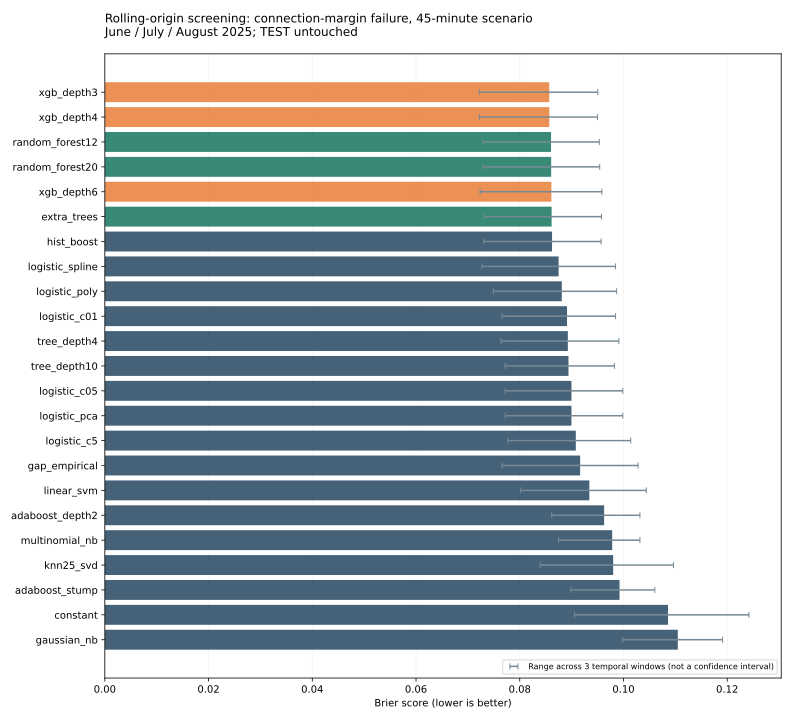
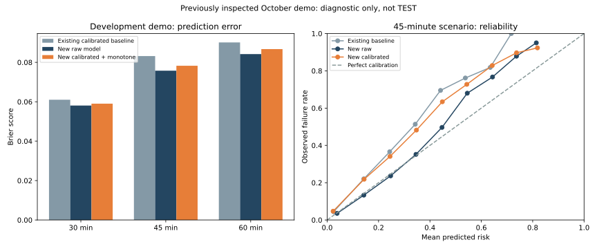

# השוואת משפחות מודלים ושיטות כיול

**TEST נותר סגור ולא הורד. האתר הקיים לא הוחלף בעקבות חיפוש זה.**

## מתודולוגיה

סינון ראשוני: חלונות זמן יוני, יולי ואוגוסט; בכל חלון אימון על עבר בלבד, עד 60,000 זוגות, ובדיקה על עד 20,000 זוגות. תרחיש 45 דקות משמש לסינון. נבדקת אי־חפיפת טיסות בין חלונות. ארבעת המובילים ומודלי הייחוס מותאמים ל־300,000 זוגות ונבדקים על כל ולידציית ספטמבר בשלושת הספים.

בחירת כיול בין ללא כיול, sigmoid, isotonic, תיקון prior ו־temperature: אימון כיול בתחילת אוקטובר ובחירה בסופו של חלון הכיול, עם הפרדה של יומיים. לאחר הבחירה מכיילים שוב על כל חלון הכיול. סוף אוקטובר הוא demo שכבר נבדק בעבר ואינו TEST עצמאי.

## סינון בחלונות זמן

| מודל | Brier ממוצע (45 דקות) | זמן כולל לשלושת החלונות, שניות |
|---|---:|---:|
| xgb_depth3 | 0.08568 | 1.4 |
| xgb_depth4 | 0.08569 | 1.8 |
| random_forest12 | 0.08603 | 69.9 |
| random_forest20 | 0.08606 | 83.6 |
| xgb_depth6 | 0.08610 | 1.9 |
| extra_trees | 0.08614 | 113.6 |
| hist_boost | 0.08623 | 2.4 |
| logistic_spline | 0.08750 | 2.1 |
| logistic_poly | 0.08810 | 2.8 |
| logistic_c01 | 0.08911 | 0.8 |
| tree_depth4 | 0.08927 | 0.6 |
| tree_depth10 | 0.08939 | 2.1 |
| logistic_c05 | 0.08997 | 0.9 |
| logistic_pca | 0.08997 | 0.9 |
| logistic_c5 | 0.09081 | 1.2 |
| gap_empirical | 0.09164 | 0.1 |
| linear_svm | 0.09341 | 0.8 |
| adaboost_depth2 | 0.09627 | 15.5 |
| multinomial_nb | 0.09782 | 0.4 |
| knn25_svd | 0.09801 | 7.4 |
| adaboost_stump | 0.09924 | 10.1 |
| constant | 0.10858 | 0.0 |
| gaussian_nb | 0.11047 | 0.9 |

## בחירה סופית בוולידציה

| סף | מודל נבחר | Brier בוולידציה | שיטת כיול |
|---|---|---:|---|
| 30 | xgb_depth3 | 0.04852 | temperature |
| 45 | xgb_depth4 | 0.06556 | sigmoid |
| 60 | xgb_depth4 | 0.07881 | sigmoid |

## כל המועמדים בוולידציה המלאה

| מודל | Brier 30 | Brier 45 | Brier 60 |
|---|---:|---:|---:|
| xgb_depth3 | 0.04852 | 0.06580 | 0.07881 |
| xgb_depth4 | 0.04855 | 0.06556 | 0.07881 |
| random_forest12 | 0.04893 | 0.06592 | 0.07881 |
| random_forest20 | 0.04919 | 0.06597 | 0.07890 |
| gap_empirical | 0.05028 | 0.06931 | 0.08472 |
| logistic_c05 | 0.04936 | 0.06893 | 0.08983 |

## השוואת כיול בתוך חלון הכיול בלבד

| שיטה | Brier 30 | Brier 45 | Brier 60 |
|---|---:|---:|---:|
| none | 0.04247 | 0.06123 | 0.07512 |
| sigmoid | 0.04137 | 0.06016 | 0.07381 |
| isotonic | 0.04152 | 0.06036 | 0.07409 |
| prior_offset | 0.04176 | 0.06105 | 0.07432 |
| temperature | 0.04131 | 0.06019 | 0.07479 |

## אבחון בהדגמה — לא בסיס לבחירה

| סף | Brier ללא כיול | Brier אחרי כיול ומונוטוניות | סיכון חזוי ממוצע | אי־עמידה נצפית |
|---|---:|---:|---:|---:|
| 30 | 0.05808 | 0.05904 | 4.10% | 6.99% |
| 45 | 0.07577 | 0.07827 | 7.14% | 11.22% |
| 60 | 0.08420 | 0.08672 | 13.90% | 18.35% |

## תפקידי המודלים והגבולות

- לוגיסטית, עצים, Random Forest, Naive Bayes, KNN, SVM ו־AdaBoost קשורים לחומר בקובץ הקורס. ExtraTrees ו־HistGradientBoosting הן הרחבות להשוואה.
- PCA נבדק על התכונות המספריות בלבד, ו־TruncatedSVD על מטריצה דלילה עבור KNN/GaussianNB; SVD לא ממורכז אינו זהה ל־PCA.
- SVM לינארי מקבל כיול פנימי על סוף חלון האימון, בלי cross-validation אקראי.
- HistGradientBoosting מקבל קודי קטגוריות כספרות כדי להתמודד עם יותר מ־255 שדות; זו מגבלת ייצוג מוצהרת.
- אין כאן ניסיון לכפות K-Means, HMM, מערכות המלצה שיתופיות או Isolation Forest על יעד סיווג שאינו מתאים להנחותיהם.
- רגרסיה לינארית אינה בחירה ראשית להסתברות בינארית, שעלולה לחרוג מ־0–1.
- נתוני היסטוריה כבר נבדקו בניסוי קודם; החיפוש הנוכחי משווה משפחות על אותן תכונות לו״ז כדי לבודד את השפעת האלגוריתם.
- חלוקת הזמן מתייחסת למועד האירוע ואינה מאמתת מתי תוויות BTS פורסמו או היו זמינות לאימון מודל 30 יום לפני נסיעה. לפני טענת תקפות למועד הזמנה יש לאכוף גם אופק תכנון ועיכוב פרסום על גבול נתוני האימון.
- ריבוי ניסויים על אותה ולידציה מגדיל סיכון להתאמת יתר; מינימום Brier אינו הוכחת הכללה או מובהקות. נדרש TEST אחרי נעילת התהליך.
- אין מחיקת חריגים רק מפני שהם איחורים קשים; אלה אירועים חשובים ליעד.
- ציוני הסתברות דורשים כיול, ושיפור Brier אינו בהכרח הוכחת תועלת בבחירת מסלול.

## תרשימים

טווחי התרשים הם מינימום ומקסימום של שלושה חלונות זמן, ולא רווחי סמך.

